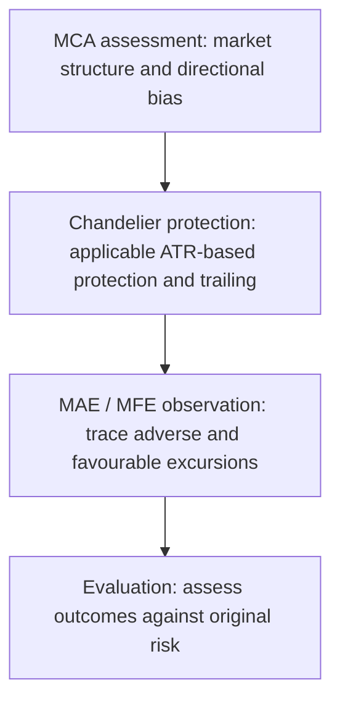

# Immediate demo stress evaluation

**Instruction prompt for Claude Code**

**Conversation reference:** № 13,685 · 12-10’26 14:45 SGT · Codex

**Source:** [HTML instruction](demo-stress-evaluation-instruction-2026-10-12.html)

This Markdown version retains the owner’s subsequent exact-account clarification and conditional Analysis instruction.

Prepared 12 October 2026 · Asia/Singapore (SGT) · Owner-requested handoff

Start a stress evaluation across the **three owner-specified demo accounts listed below**. Target **24 open positions per account, 72 total**, within the existing account risk and margin limits.

The purpose is to exercise the recently completed PR work, expose failures, observe the bot’s recovery, and correct reproduced defects. Opening positions alone does not establish that every management feature works.

**Demo execution only.** Resolve account identities and verify execution readiness before starting. Preserve live accounts, their positions, configuration and management. Use existing risk limits and supported execution paths.

## 1. Establish the execution scope, then start immediately

**Owner-specified demo accounts · balances reported by the owner on 12 October 2026**

| Environment | Broker login | Account ID | Currency | Reported balance |
| --- | --- | --- | --- | --- |
| Demo | 5067353 | `43097342` | SGD | 3,057.16 |
| Demo | 5306502 | `47790949` | USD | 42,847.81 |
| Demo | 5203012 | `46130058` | USD | 30,009.96 |

Use these exact account IDs. Verify each broker login, demo status, account currency and current balance against the existing registry and fresh broker account information. The balances above are owner-reported snapshots, not live observations or identity evidence. Keep SGD and USD accounting separate.

**Turn on Analysis for any of these three accounts where it is currently off.** Use the existing supported account-scoped setting, retain the before/after state and verify the update by fresh readback. Leave Analysis unchanged where it is already on. This requested Analysis change does not authorize changing Auto-trade switches, risk limits or live-account settings.

Report the verified IDs, actual balances, Analysis states, enabled management policies and deployed commit. Then begin placing valid demo stress entries through the supported execution path without requesting another routine confirmation.

If an account identity or Analysis state cannot be verified, report the exact discrepancy and resolve it before that account’s entries. Never substitute another account.

Use strategy logic to construct **test order setups**. These are intentionally requested demo stress entries; label them accordingly and do not report them as naturally generated strategy signals.

Preserve live accounts, their positions, configuration and management. Read the current coordination notes before overlapping another agent’s work.

## 2. Build a coverage matrix

Target this distribution on **each account**:

**Primary coverage per demo account**

| Primary test group | Positions | Main coverage |
| --- | --- | --- |
| Nearest eligible key-level TP | 4 | Structural target selection, fill anchoring, applicable R:R constraints |
| Fixed reward:risk TP | 4 | Initial-risk calculation, stop/target placement, resolved R:R policy |
| Hybrid take-profit | 4 | Partial execution, residual position, retained protection, subsequent management |
| Momentum trading | 4 | Supported momentum entry, book ownership, initial risk and exit management |
| Tick entries and exits | 4 | Supported tick-triggered paths, timestamps, eligibility and exit receipts |
| Lot-management cases | 4 | Valid minimum/step sizes, risk-based sizing, supplied lots and margin checks |
| Total | 24 | Repeat across the three verified demo accounts |

Distribute supported instruments, directions and timeframes across these groups. Avoid making all positions equivalent exposures.

Overlay these checks wherever applicable:

- Strategy setup provenance and execution eligibility.
- Tick-derived and timeframe bar inputs.
- Market Causality Approach (MCA).
- Maximum Adverse Excursion (MAE).
- Maximum Favourable Excursion (MFE).
- Chandelier protection and trailing.
- Whole-position net results after costs.

The same position may exercise several features. Record its primary group and secondary coverage.

Use currently supported paths and resolved policies. An unsupported bar form, disabled controller or legitimately rejected setup must be reported explicitly. Do not bypass a gate or enable a controller merely to complete the matrix.

## 3. Open the demo positions now

Submit bounded waves of **six positions per account**, rotating across the three accounts until the target is reached. Observe execution and management between waves.

For every position:

- Calculate lots from that account’s applicable policy, actual instrument specifications and current margin.
- Obtain broker-confirmed execution and reconcile actual quantity and fill price.
- Verify the intended broker-side SL/TP.
- Record the immutable initial-risk evidence separately from subsequent stop changes.
- Confirm which bot controller owns and manages the position.

Do not copy identical lot sizes across accounts with different balances or currencies. Use each account’s native-currency risk budget and the applicable instrument/currency conversions. Do not increase risk limits, remove protection or override account safeguards to reach 24 positions.

If existing limits prevent the target, report the achieved count and exact constraint. A correct rejection is a successful safeguard test, not a defect.

## 4. Exercise failure and recovery deliberately

Use normal demo execution to observe real broker and controller behaviour.

Create deterministic faults through an **isolated, account-scoped test harness or controlled transport boundary**. Do not inject faults into a shared production database, broker feed or process where live accounts could be affected.

Cover:

- Rejected orders and invalid-size proposals.
- Timeout or lost acknowledgement after broker acceptance.
- Partial fills and underfills.
- Duplicate responses and repeated reconciliation.
- Delayed, stale or account-mismatched snapshots.
- Interrupted execution and controller recovery.
- SQLite busy/write failures and spill short writes in isolated tests.
- Tick gaps, truncated gap lists and out-of-order events.

Expected recovery includes:

- No duplicate order or close submission after an ambiguous response.
- No success latch or journal entry based only on requested quantity.
- Actual fills and residual quantities reconciled before completion.
- Account isolation preserved.
- Existing protection retained.
- Recovery bookkeeping committed consistently and once.

Separate **injected failures**, **naturally observed failures**, **expected rejections** and **confirmed defects**. Never fabricate broker execution evidence.

## 5. Verify each feature through receipts

For TP methods, compare the intended target with the accepted broker target and actual exit.

For hybrid TP, prove the partial deal, executed quantity, remaining quantity, retained SL/TP and durable bookkeeping.

For lot management, verify requested versus accepted quantity, instrument rounding, risk and margin.

For momentum and tick paths, identify the actual triggering event, account, controller and resulting execution. A position opened through a generic manual path does not prove that a tick-entry path works.

For bar forms, verify timestamps, price side, event-count semantics, gaps and contiguous lookbacks. Separate research bar comparisons from actual broker execution.

For MCA, record the entry-time structural assessment and directional bias. Measure MAE and MFE from traceable market data against the original position risk.

Follow the illustrated sequence where applicable:

MCA assesses structure and directional bias. Chandelier provides applicable ATR-based protection. MAE and MFE record adverse and favourable excursions. Evaluation follows without automatically changing the ATR multiplier.

MCA assessment → Chandelier protection → MAE/MFE observation → evaluation.

Do not automatically change the ATR multiplier because a stress trade loses. Parameter optimisation is a separate analysis.

## 6. Let the bot recover, then correct confirmed defects

Observe the bot’s existing recovery first. Capture evidence before intervening.

For each confirmed defect:

1. Identify the failing mechanism and affected commit/path.
2. Reproduce it through the real relevant controller/database boundary with controlled transport.
3. Implement the smallest correction.
4. Preserve account eligibility, risk policy, sizing rules and protection contracts.
5. Validate recovery, duplicate prevention and successful ordinary behaviour.
6. Run the applicable gates and inspect the actual **GitHub Codex reviewer — `chatgpt-codex-connector[bot]`** findings.

Do not weaken safeguards, suppress failures or alter strategy thresholds to obtain a passing result. Do not merge or deploy merely because this prompt requests stress testing; follow the owner’s existing release authorization.

## 7. Monitor and report

During execution, monitor account-owned reconciliation, advancing quote timestamps, management progress, independent broker protection, resource pressure and SQLite contention.

If protection fails, account identity becomes uncertain, or existing operational limits are exceeded, stop submitting further stress entries and follow the existing recovery procedure. Preserve management of positions already open.

Deliver:

- Account IDs, broker logins, currencies, Analysis before/after states, deployed commit and execution window.
- Requested, accepted, rejected, open and closed counts per account.
- Coverage matrix with evidence links.
- MAE, MFE, initial R and whole-position net results.
- Failure, recovery and correction receipts.
- Features actually exercised versus still unverified.
- Proposed cleanup of remaining stress positions and any unresolved defects.

Do not infer completion from order count, green CI, HTTP success or protection presence alone. **Start the valid demo entries immediately after identity and execution checks, then report measured outcomes.**
